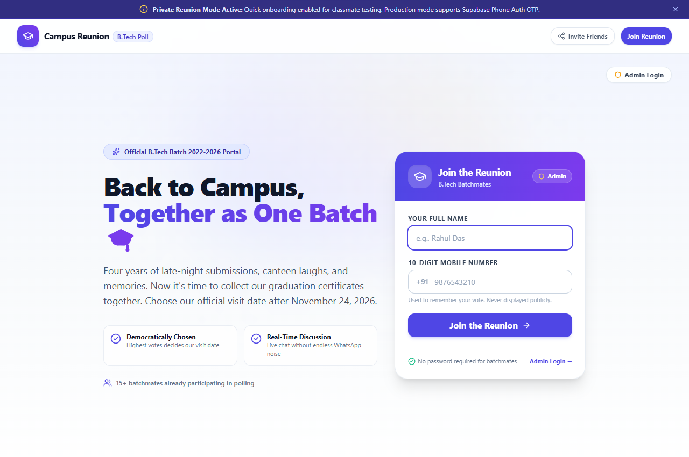
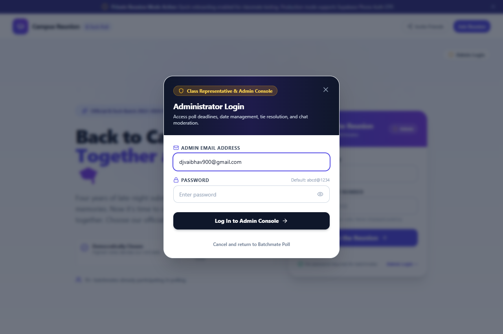
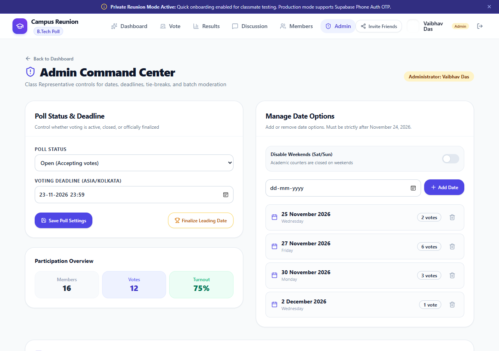
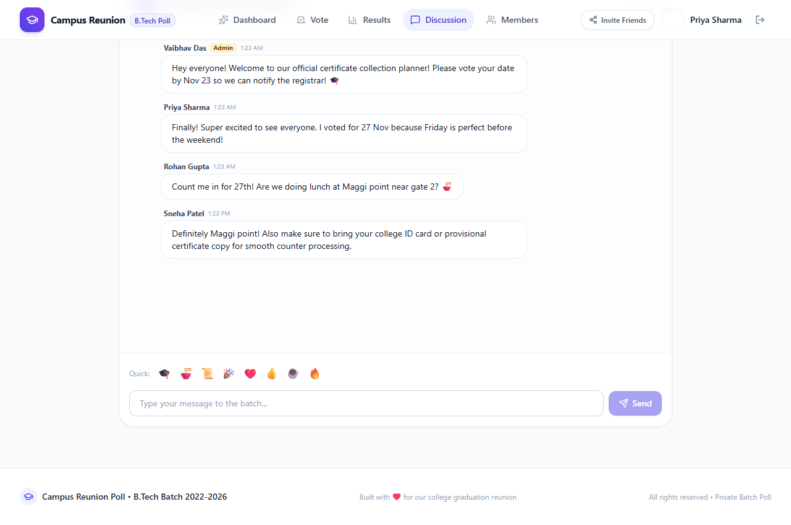

# 📋 Standard Operating Procedure (SOP) — Administrator

> **Role:** Class Representative & Polling Administrator (Vaibhav Das)  
> **System:** Campus Reunion Poll — B.Tech Certificate Collection Planner  
> **Document Ref:** `SOP-ADM-2026-V1`  

---

## 📌 Document Overview & Purpose

This Standard Operating Procedure (SOP) defines the operational workflow, authority boundaries, security protocols, and coordination actions for administering the **Campus Reunion Poll**.

The objective of this procedure is to ensure a transparent, democratic, and error-free scheduling process for the **B.Tech Batch of 2022–2026** to collectively visit the college campus and receive their degree certificates.

---

## 🖼️ Visual System Architecture & Admin Interfaces

| Screenshot | Description |
| :--- | :--- |
|  | **Homepage with Corner Admin Access:** Dedicated Admin Login button in the top-right corner. |
|  | **Administrator Authentication:** Secure Email & Password dialog restricted to the Class Rep. |
|  | **Admin Control Center (`/admin`):** Live controls for poll deadline, date options, weekend toggle, and tie-breaking. |

---

## 1. SOP Step 1: Administrator Authentication

### 1.1 Credentials
- **Authorized Email:** `djvaibhav900@gmail.com`
- **Password:** `abcd@1234`
- **Class Representative:** Vaibhav Das
- **Primary Mobile:** `6297977842`

### 1.2 Login Procedure
1. Navigate to the application root (`/`).
2. Click the **Admin Login** button located at the **top-right corner** of the screen (or the **Admin** shield pill on the join card).
3. Enter `djvaibhav900@gmail.com` into the email field.
4. Enter `abcd@1234` into the password field.
5. Click **Log In to Admin Console**.
6. Upon successful authentication, the system sets a cryptographically signed `HttpOnly` JWT cookie (`role: "admin"`) and redirects to `/admin`.

---

## 2. SOP Step 2: Date Option Configuration & Weekend Policy

### 2.1 Date Eligibility Criteria
- **Mandatory Business Rule:** All proposed visit dates must be **strictly after November 24, 2026**.
- **Earliest Selectable Date:** `November 25, 2026` (`2026-11-25`).
- The database schema strictly blocks any date prior to `2026-11-25` via check constraints:
  ```sql
  CONSTRAINT min_date_after_nov_24_2026 CHECK (min_date >= '2026-11-25')
  ```

### 2.2 Adding New Date Options
1. Go to **Admin Control Center** (`/admin`) → **Manage Date Options**.
2. Select a date using the date picker.
3. If the **Disable Weekends** toggle is active, Saturdays and Sundays are blocked to prevent picking days when college administrative offices are closed.
4. Click **Add Date Option**.
5. The option is immediately propagated to all batchmates in real-time.

### 2.3 Removing a Date Option
1. Locate the option in the date list under **Manage Date Options**.
2. Click the **Remove (Trash)** button.
3. The platform re-assigns or cancels affected ballots, recalculates turnout percentages, and writes an entry into `poll_audit_logs`.

---

## 3. SOP Step 3: Managing Voting Deadlines & Poll Status

### 3.1 Poll Lifecycle States
```
┌─────────┐       ┌────────┐       ┌──────────┐       ┌───────────┐
│  Draft  │  ──>  │  Open  │  ──>  │  Closed  │  ──>  │ Finalized │
└─────────┘       └────────┘       └──────────┘       └───────────┘
```

1. **Open:** Polling is active. All batchmates can cast or change votes.
2. **Closed:** Cutoff reached. Ballots are locked, and no further vote modifications are allowed.
3. **Finalized:** The winning date is officially confirmed. A prominent celebration banner is published across the platform.

### 3.2 Setting the Cutoff Time
- Enter the cutoff date and time under **Voting Deadline**.
- Time is standardized in `Asia/Kolkata` (`IST`).
- When the deadline expires, the voting form locks automatically without requiring manual intervention.

---

## 4. SOP Step 4: Tie-Breaking & Decision Protocol

### 4.1 Strict Democratic Rule
> **Rule:** If two or more dates receive equal highest votes, the platform flags `is_tie = true`. The system **must never silently default to the earliest date**.

### 4.2 Resolution Procedure
1. Verify tie notification under **Standings & Tie Status**.
2. Contact the **Academic Section / Registrar** to verify counter staffing for the tied dates.
3. Under **Resolve Poll Tie**:
   - Select the approved date from the tied options.
   - Enter an **Auditable Justification Note** (e.g., *"Academic Cell confirmed all 4 certificate distribution counters open on 27 Nov"*).
4. Click **Resolve Tie & Finalize Date**.
5. The decision is saved to PostgreSQL with `tie_resolved_by` and `tie_resolution_note`.

---

## 5. SOP Step 5: Discussion Forum Moderation



### 5.1 Moderation Policy
- Remove abusive language, external promotions, or spam immediately.
- Messages submitted by batchmates can be soft-deleted by clicking the red **Trash** icon.
- Soft-deleted messages display: *"This message was removed by the administrator."*

---

## 6. SOP Step 6: Certificate Day Coordination & WhatsApp Broadcast

### 6.1 WhatsApp Broadcast Protocol
Once the winning date is finalized, copy and broadcast the following notice to all batch groups:

```text
🎓 *OFFICIAL B.TECH DEGREE COLLECTION VISIT DATE FINALIZED* 🎓

Dear Batchmates (Class of 2022–2026),
Through our democratic Campus Reunion Poll, the official date to visit our college and collect our certificates has been confirmed!

📅 *Winning Date:* [Winning Date, e.g. Friday, 27 November 2026]
⏰ *Reporting Time:* 10:30 AM IST
📍 *Assembly Point:* Main Academic Building (Near Canteen)

📋 *Mandatory Items to Carry:*
1. College Student ID Card (or Aadhaar Card)
2. Library & Laboratory No-Dues Clearance Slip
3. Final Semester Marksheet / Provisional Certificate copy
4. 4 Passport-size Photographs

Let's meet up and collect our graduation certificates together! 🎓
Full Live Results: https://dev-pool-sable.vercel.app/
```

---

## 7. SOP Step 7: Incident Response & Emergency Procedures

| Issue | Root Cause | Standard Recovery Action |
| :--- | :--- | :--- |
| **Batchmate cannot cast vote** | Polling status is `closed` or `draft` | Check **Poll Status** on `/admin` and set to `open`. |
| **User entered wrong phone** | Typo in mobile input | Instruct user to log out and rejoin with their correct 10-digit number. |
| **Disputed Winner** | Tied votes on deadline | Follow [SOP Step 4](#4-sop-step-4-tie-breaking--decision-protocol) to record official justification note. |
| **Database Disconnect** | Invalid cloud credentials | System automatically operates in persistent local store mode without data loss. Check `.env` keys. |

---

*Standard Operating Procedure approved for Campus Reunion Poll Administration.*

