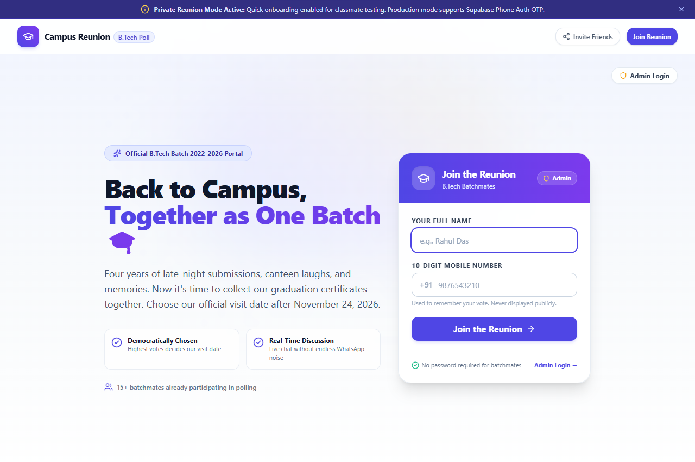
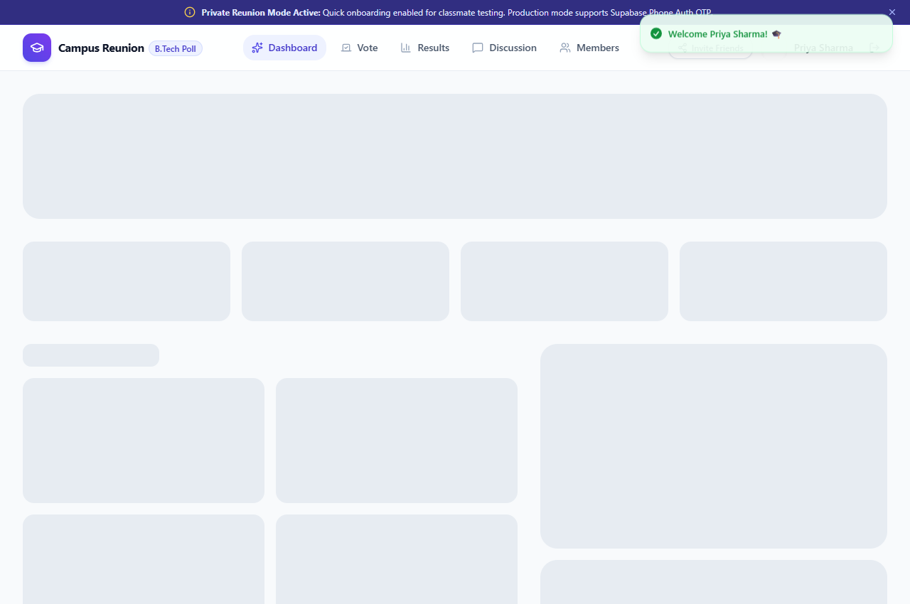
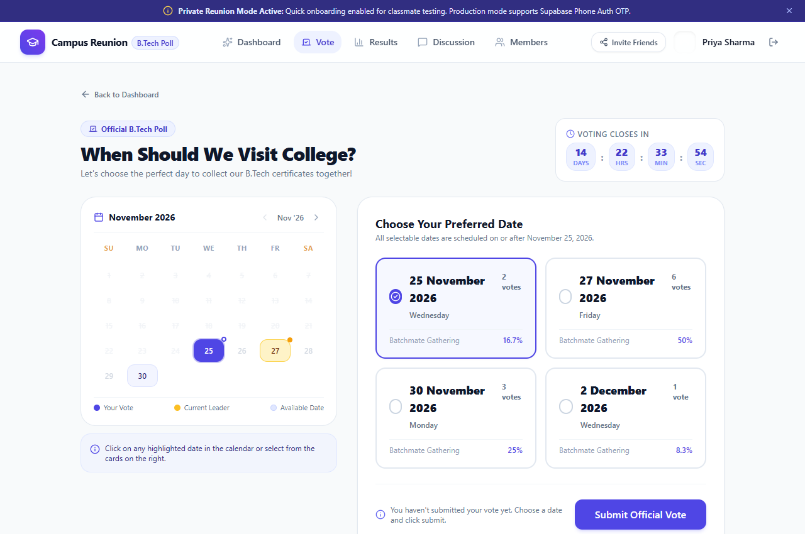
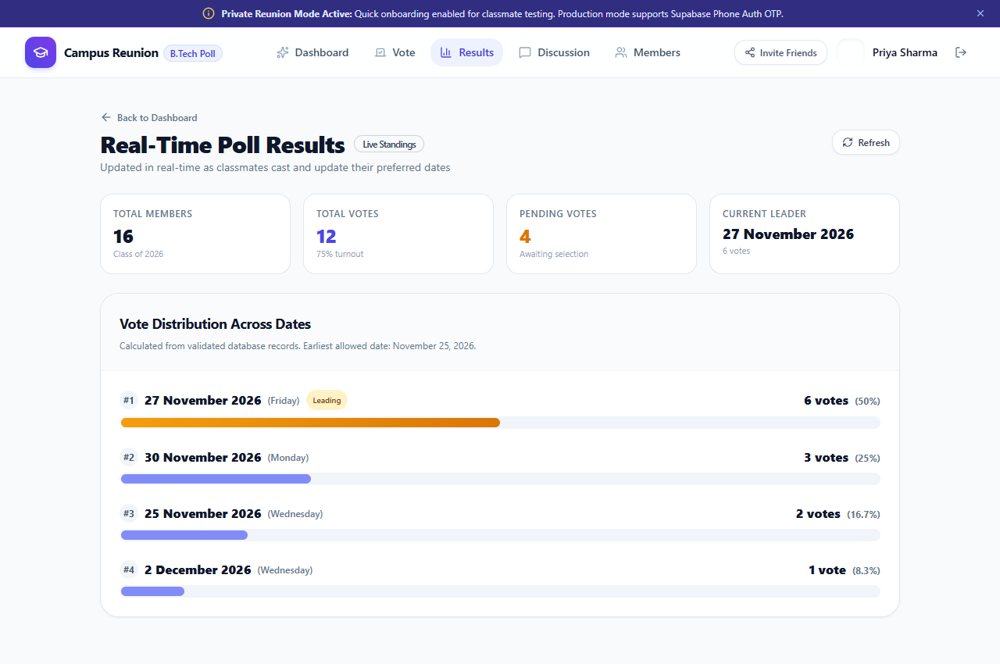
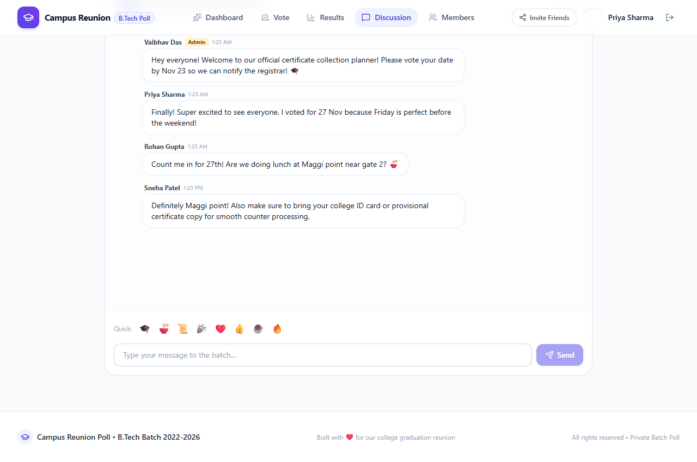
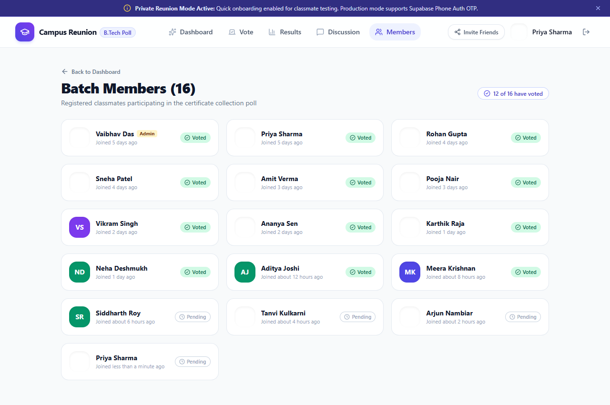

# 📋 Standard Operating Procedure (SOP) — Students & Batchmates

> **Target Audience:** Graduating B.Tech Classmates (Batch 2022–2026)  
> **System:** Campus Reunion Poll — B.Tech Certificate Collection Planner  
> **Document Ref:** `SOP-USR-2026-V1`  

---

## 📌 Document Overview & Purpose

This Standard Operating Procedure (SOP) guides graduating B.Tech students on how to join the reunion platform, cast and update their preferred campus visit date, track democratic election standings, participate in group discussions, and prepare for degree collection day.

---

## 🖼️ Visual User Flow & Feature Gallery

| Step | Screenshot | Description |
| :---: | :--- | :--- |
| **1** |  | **Simple Onboarding:** Enter Full Name & 10-Digit Mobile (no passwords required). |
| **2** |  | **Reunion Dashboard:** View personal vote status, turnout metrics, checklist, and quick links. |
| **3** |  | **Voting Interface:** Browse eligible dates starting Nov 25, 2026 via interactive calendar and date cards. |
| **4** |  | **Live Standings:** Real-time horizontal progress bars, vote percentages, and leader announcement. |
| **5** |  | **Reunion Chat:** Real-time chat with emojis, message grouping, and self-deletion. |
| **6** |  | **Batch Directory:** Privacy-safe list showing who has voted (mobile numbers hidden). |

---

## 1. SOP Step 1: Password-Free Onboarding & Login

```
┌────────────────────────────────────────────────────────┐
│  Step 1: Open https://dev-pool-sable.vercel.app/       │
│  Step 2: Enter your Full Name (e.g. Priya Sharma)      │
│  Step 3: Enter your 10-Digit Indian Mobile Number      │
│  Step 4: Tap "Join the Reunion" 🎓                     │
└────────────────────────────────────────────────────────┘
```

### 1.1 Privacy Guarantee
- Your mobile number is **strictly confidential**. It is used solely as your unique voter ticket so your vote and chat messages are restored when you return.
- Phone numbers are never shown to other students, never displayed in chat, and never listed in the public directory.

---

## 2. SOP Step 2: Casting & Changing Your Vote


### 2.1 Date Eligibility
- All selectable dates are strictly **on or after November 25, 2026**.
- The Academic Cell confirmed that degree certificates cannot be collected prior to this date.

### 2.2 Voting Procedure
1. Tap **Vote** on the top menu (or bottom tab bar on mobile).
2. Choose between **Calendar View** and **List View**.
3. Tap your preferred date card.
4. Tap **Confirm My Vote**.
5. A green toast notification will confirm: *"Your vote for [Date] has been recorded!"*

### 2.3 Modifying Your Vote
- You can change your selection at any time before the deadline closes.
- Select a new date card and confirm.
- **Single Vote In-Place Update:** The platform replaces your previous vote automatically. Duplicate active votes cannot occur.

---

## 3. SOP Step 3: Checking Democratic Standings & Winner


Navigate to the **Results** tab to view real-time statistics:
- **Total Registered Batchmates:** Number of classmates who have joined the portal.
- **Turnout Percentage:** Percentage of classmates who have submitted a ballot.
- **Leading Date:** Currently leading date (updated in real-time without refreshing).
- **Official Final Date:** When the administrator closes the poll, the winning date is declared with a celebration banner:
  > 🎉 *"It's Official! We're Meeting on 27 November 2026!"*

---

## 4. SOP Step 4: Participating in the Reunion Chat


1. Open the **Discussion** tab.
2. Type your message in the chat input.
3. Use quick graduation emojis: `🎓`, `🍜`, `📜`, `🎉`, `❤️`, `👍`, `☕`, `🔥`.
4. Tap **Send** (or press Enter).
5. **Self-Deletion:** If you make a typo, tap the trash icon next to your message to delete it.

---

## 5. SOP Step 5: Degree Collection Day Preparation

Open the **Checklist** modal from the Dashboard before traveling to the college:

| Item # | Mandatory Document | Check |
| :-: | :--- | :-: |
| **1** | **College Student ID Card** (or Government Photo ID) | [ ] |
| **2** | **Library No-Dues Clearance Slip** | [ ] |
| **3** | **Departmental / Lab Clearance Receipt** | [ ] |
| **4** | **Provisional Certificate / Final Grade Card copy** | [ ] |
| **5** | **4 Formal Passport-size Photographs** | [ ] |

> [!IMPORTANT]
> **Counter Timings:** Academic Section certificate distribution counters operate from **10:00 AM to 4:00 PM IST**. Please arrive by 10:30 AM at the Main Academic Building to collect certificates and take batch photos together!

---

## 6. SOP Step 6: Installing as a Mobile App (PWA)

Campus Reunion Poll supports native mobile installation:

### Android Devices (Chrome)
1. Open the website in Google Chrome.
2. Tap the three dots menu (**⋮**) in the top right.
3. Tap **Install app** or **Add to Home screen**.
4. Launch directly from your app drawer!

### iOS Devices (Safari)
1. Open the website in Safari.
2. Tap the **Share** button (box with an upward arrow) at the bottom.
3. Tap **Add to Home Screen**.
4. Tap **Add** in the top right.

---

*Standard Operating Procedure approved for B.Tech Class of 2026 Batchmates.*
